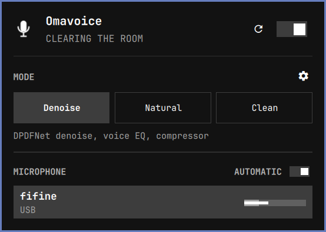
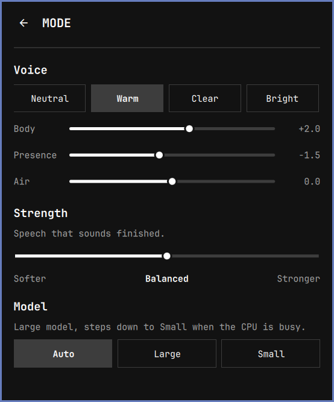

# Omavoice DPDFNet

<p align="center">
  
</p>

<p align="center">
  <strong>Your voice, better heard.</strong><br>
  A virtual microphone with DPDFNet noise suppression. One source. Two modes. Noise stays on this side of the call.
</p>

<p align="center">
  <a href="LICENSE"></a>
  
  
  
</p>

<p align="center">
  
  
</p>

A fork of [Omavoice](https://github.com/gigasolo/omavoice) by GigaSolo for [Omarchy](https://omarchy.org/) 4 (Quattro). It swaps RNNoise and DeepFilterNet for **DPDFNet**, which cleaned speech best in a side-by-side test, and drops the rest: no Meeting preset, no echo cancel, no engine picker.

Pick **Omavoice** in a call app, OBS, or a browser. The plugin sits under those apps as a PipeWire source, so you do not configure each one. USB mics attach themselves when you plug them in.

Not affiliated with or endorsed by GigaSolo, Ceva, or 37signals.

---

## Modes

| | Denoise | Clean |
| --- | --- | --- |
| **For** | Calls, OBS, interviews, recording | Program mixes, music beds |
| **Does** | High-pass + DPDFNet + voice EQ + compressor | High-pass only |
| **Keeps** | Speech that sounds finished | Applause, keys, and music |

Right-click the mark to toggle. Open the panel to switch the mode and pick a microphone. The selected mic row shows a live level and a hairline of what Omavoice is sending. Other rows stay quiet so a Bluetooth headset is not grabbed. The settings on MODE set a Voice look (Neutral / Warm / Clear / Bright) with Body / Presence / Air knobs, and the Strength of the denoise. On Clean, both are visible and disabled.

In the app itself, choose **Omavoice** as the microphone and turn *its* noise cancellation off. Two denoisers stacked sound hollow.

## Install

DPDFNet comes from [HushMic](https://github.com/Fovty/hushmic), which ships it as a LADSPA plugin. Install that package first, then the plugin:

```sh
omarchy pkg aur add hushmic-bin
omarchy plugin add https://github.com/heast13/omarchy-omavoice-dpdfnet.git --enable
```

Omavoice only loads HushMic's plugin and model. The HushMic app itself does not need to run, and must not be the input you pick in your apps.

> [!IMPORTANT]
> This fork replaces upstream Omavoice. Both publish a PipeWire source called `omavoice`, so never enable them together. Remove `gigasolo.omavoice` first.

> [!IMPORTANT]
> Plugins run as unsandboxed code inside `omarchy-shell`. Only add repos you trust, and read the source before you enable one.

### Without the HushMic package

Omavoice looks in `~/.local/share/omavoice/dpdfnet/` first. You can copy these files there from a `hushmic-bin` release and uninstall the package:

```
libdpdfnet_ladspa.so            # /usr/lib/ladspa/
dpdfnet8_48khz_hr.onnx          # /usr/share/hushmic/models/
dpdfnet8_48khz_hr.weights.f32   # /usr/share/hushmic/models/ (optional: faster native engine)
libonnxruntime.so               # /usr/lib/hushmic/libonnxruntime.so.1.*, renamed
```

Copy all of them from the same release. Without DPDFNet, Denoise skips noise suppression and the compressor (high-pass and voice EQ stay), and the panel says **DPDFNet missing**. Click **reload** after installing or copying.

Softer / Balanced / Stronger cap the suppression at 24 / 48 / 100 dB. DPDFNet adds about 40 ms of latency.

## Use

| Action | How |
| --- | --- |
| Open or close the panel | Left-click the mark |
| Tune Denoise | Settings on MODE: Voice look, then Softer / Balanced / Stronger |
| Automatic microphone | AUTOMATIC on the MICROPHONE header |
| Toggle Omavoice | Right-click, or `o` |
| Reload processing | Reload next to on/off, or `r` |
| Denoise / Clean | `d` / `c` |
| Move | Arrow keys or `h` `j` `k` `l` |
| Activate | Enter |
| Close | Escape |

USB capture is preferred when it appears, and stereo USB is mixed down to mono. Laptop mics and Bluetooth headsets stay in the picker. Auto stays on the USB you are using if several are plugged in; pin one if you want a specific device.

## How it sits in the graph

```
USB / laptop / BT mic
        │
        ▼
  Omavoice  (pipewire -c, its own client)
   Denoise · Clean
        │
        ▼
  call app · OBS · browser
```

The host is a dedicated PipeWire client, the same isolation Omarchy uses for speaker tuning. It does not write into that tuning, and it does not load stock `filter-chain.conf.d`. Disable the plugin and the chain stops. With no listener the host suspends. Restore goes back to the microphone Omavoice replaced, not to Omavoice itself.

## Update and remove

```sh
omarchy plugin update heast13.omavoice-dpdfnet
omarchy restart shell
omarchy plugin remove heast13.omavoice-dpdfnet
```

`omarchy plugin update` shows the diff and fast-forwards the git checkout. Removing the plugin does not change your other audio devices.

## If something is wrong

**The mark is missing.** Confirm it is enabled:

```sh
omarchy plugin list | grep omavoice
omarchy plugin enable heast13.omavoice-dpdfnet --section right
```

**The panel says DPDFNet missing.** Install `hushmic-bin`, or check the files in `~/.local/share/omavoice/dpdfnet/`, then **reload**.

**Omavoice is silent.** WirePlumber remembers a mute on the source. Check `pactl get-source-mute omavoice`. If it is not muted, the DPDFNet files may not match: the plugin emits silence when ONNX Runtime or the model fails to load. Copy all files from the same HushMic release.

**The app still hears the raw USB mic.** Select **Omavoice** inside the app, not the hardware device.

**The voice sounds hollow.** The app is probably denoising too. Turn that off.

## Develop

```sh
git clone https://github.com/heast13/omarchy-omavoice-dpdfnet.git
cd omarchy-omavoice-dpdfnet
./tests/run
```

That runs the Model tests, the graph and script tests, and `omarchy plugin validate .`, the same check Omarchy runs before it installs a plugin.

## Credits

- [Omavoice](https://github.com/gigasolo/omavoice) by GigaSolo LLC (MIT): the plugin this fork is built on, including the logo and the tagline.
- [DPDFNet](https://github.com/ceva-ip/DPDFNet) by Ceva (Apache-2.0): the speech-enhancement model ([paper](https://arxiv.org/abs/2512.16420)).
- [HushMic](https://github.com/Fovty/hushmic) by Fovty (MIT OR Apache-2.0): the LADSPA plugin, the native engine, and the bundled ONNX Runtime (Microsoft, MIT).

This repo contains no binaries, models, or weights. They come from your HushMic install.

## Changelog

See [CHANGELOG.md](CHANGELOG.md).

## License

[MIT](LICENSE). Copyright (c) 2026 GigaSolo LLC, Copyright (c) 2026 heast13.

```
SPDX-License-Identifier: MIT
```

Omarchy is a trademark of its respective owners.
